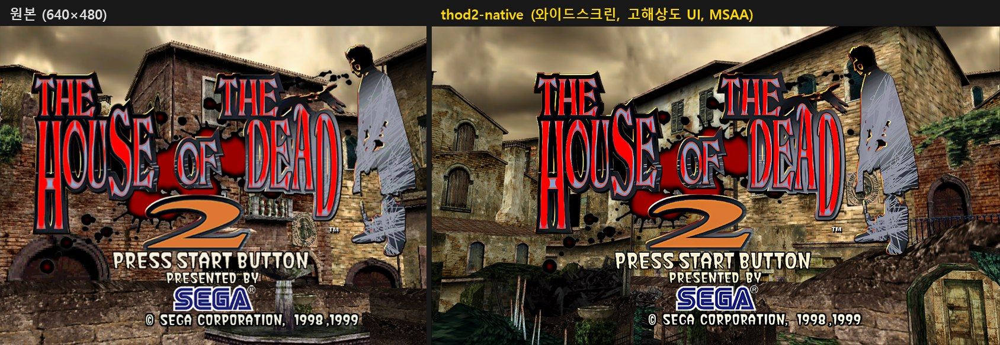
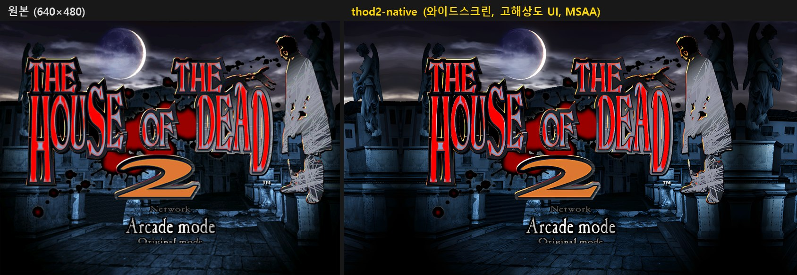
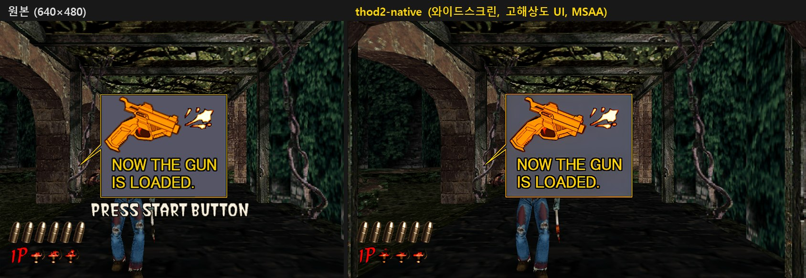
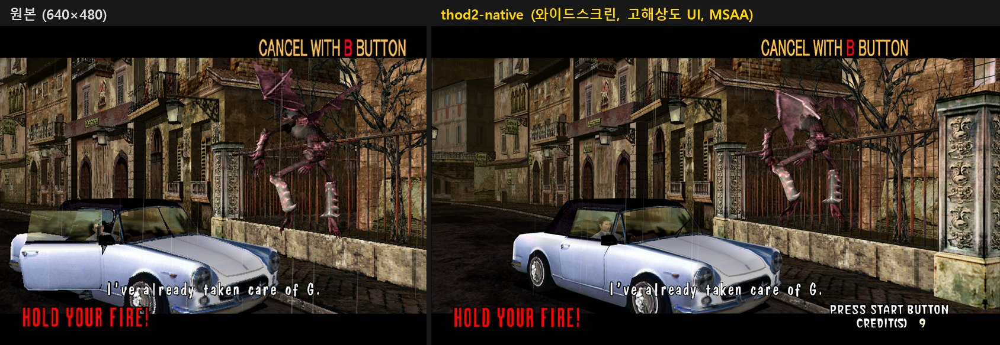
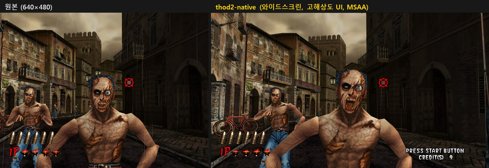
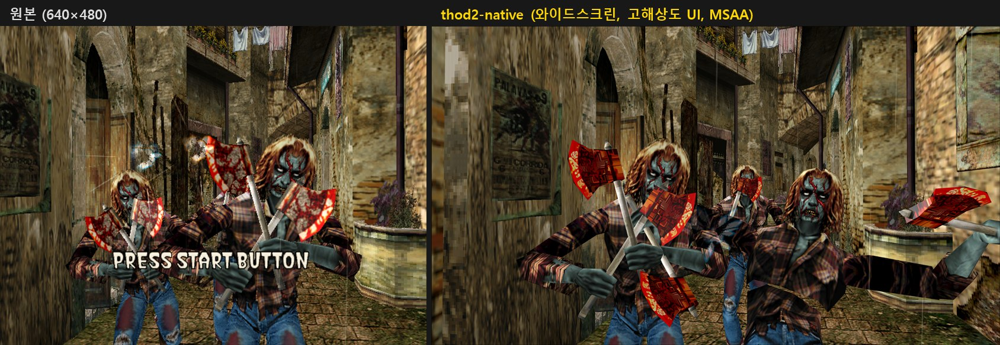

[한국어](README.md) | **English** | [日本語](README.ja.md)

# thod2-native

### [Download the latest version (thod2-native.zip)](https://github.com/BangJeongHyeok/thod2-native/releases/latest/download/thod2-native.zip)
(Optional) [High-resolution UI texture pack (thod2-native-hd-ui.zip, about 400 MB)](https://github.com/BangJeongHyeok/thod2-native/releases/download/hd-ui-1/thod2-native-hd-ui.zip) · Older versions and change notes are on the [Releases](https://github.com/BangJeongHyeok/thod2-native/releases) page.

A mod that makes the PC version of **The House of the Dead 2** (SEGA, 2001) run well on modern Windows.
It works on top of the original game, and **no game files are included.**
You copy its files into your own copy of the game.

## What changes

| | Original | With thod2-native |
|---|---|---|
| Display | Full screen that switches the monitor to 640×480, 4:3 | Borderless full-screen window. Keeps your monitor's resolution and aspect ratio |
| 3D resolution | 640×480 | The highest resolution that fits the screen (1440×1080 on a 1080p monitor), anti-aliasing |
| High refresh rate (optional) | 60 frames per second | As smooth as your 144 Hz / 240 Hz monitor (game speed stays the same) |
| Menus, HUD, text (optional) | Low-resolution pictures made for 640×480 | 4× sharper with the high-resolution UI texture pack |
| CPU usage | One core at 100% | About 25% |
| Alt+Enter | Does nothing | Switches between window and full screen |
| Mouse aiming | In a window, only the top-left corner of the screen can be aimed at | The whole screen |
| Saves | Silently fail when the game folder is not writable | Saved in `%APPDATA%\thod2-native\save\` |
| Startup confirmation dialog | Every time | Never |

## Compared with the original







## What you need

1. **The game folder of The House of the Dead 2 for PC**
   - One `Hod2.exe` is supported at the moment: SHA-256 `1D71265096661CF034568FF71184FCBBED0CD9AEA0E5E2F041801C39A0FFCE69`
   - With another version, the game runs as before and only the thod2-native features stay off. Please tell us through "Reporting problems" below; it helps support more versions.
2. [**dgVoodoo2**, official release](https://github.com/dege-diosg/dgVoodoo2/releases) (tested version: 2.87.5)
   - A tool that runs old DirectX 7 games on modern graphics cards.
   Its license does not let us include it, so please download it separately.

## Installation

1. Download `thod2-native.zip` with **Download the latest version** above and extract all of its files into the game folder (next to `Hod2.exe`).
2. Download the dgVoodoo2 zip and copy these 3 files from it into the game folder:
   - `MS\x86\DDraw.dll`
   - `MS\x86\D3DImm.dll`
   - `dgVoodoo.conf`
3. Run `Hod2.exe`. If `thod2-native.log` appears in the game folder, thod2-native is working.

### High-resolution UI textures (optional)

Replaces 2D pictures such as menus, the HUD, on-screen instructions and subtitles with 4× resolution versions. The right side of the comparison pictures above uses this pack.

1. Download the [**high-resolution UI texture pack**](https://github.com/BangJeongHyeok/thod2-native/releases/download/hd-ui-1/thod2-native-hd-ui.zip) (`thod2-native-hd-ui.zip`) linked at the top.
2. Extract it into the game folder (where `Hod2.exe` is), so that the `data\tex` folder sits next to `Hod2.exe` as below.
   Windows' "Extract All" creates a new folder named after the zip by default, so change the destination to the game folder.
   ```text
   THOTD2\
     Hod2.exe
     thod2_core.dll
     data\
       tex\
         common\
         scr_common\
         ... (119 folders, 3,110 pictures)
   ```
3. Start the game. The textures are used right away; there is nothing to configure.

- It only works with thod2-native installed. The original game alone does not read this folder.
- `thod2-native.log` shows whether it works: every replaced texture leaves a line such as `replace_textures: texture 10B1 512x32 -> 2048x128`.
- To go back to the original pictures, delete the `data` folder, or change `replace_textures = 1` under `[assets]` in `thod2-native.ini` to `0`.
- You do not need to download the texture pack again when you update thod2-native.

## Settings

Open `thod2-native.ini` in the game folder with Notepad, change it, save it and restart the game. The common ones:

| To get | Change |
|---|---|
| Widescreen | `widescreen = 1` under `[display]` |
| Smooth motion on a high refresh rate monitor | `interpolate = 1` under `[display]` (leave it off on a 60 Hz monitor) |
| Anti-aliasing strength | `antialiasing = ` under `[dgvoodoo]` followed by `2x`, `4x` (default), `8x` or `16x`. Higher values give smoother edges and more work for the graphics card. `16x` only works if your graphics card supports it |
| No anti-aliasing | `antialiasing = off` under `[dgvoodoo]` |
| Smoother textures | `filtering = 16` under `[dgvoodoo]` |
| Set up dgVoodoo2 yourself | `preset = 0` under `[dgvoodoo]` |

All settings are listed under "설정" (Settings) in [docs/INSTALL.md](docs/INSTALL.md) (Korean).

## Updating and uninstalling

- **Update:** Extract the new `thod2-native.zip` the same way. If you are asked whether to overwrite `thod2-native.ini`, choose "No" to keep your settings.
- **Uninstall:** Delete `dinput.dll`, `thod2_core.dll`, `DDraw.dll` and `D3DImm.dll` (and the `data` folder if you installed the texture pack) from the game folder. Your saves stay in `%APPDATA%\thod2-native\save\`. To continue them in the original game, copy the files in it over the same places in the game folder.

## Not tested yet

These parts could not be checked during development. If you notice anything strange, please let us know.

- Playing the whole game from start to end (especially boss fights and the stage result screens)
- Other PCs and graphics cards, Windows display scaling (125%, 150%, ...)
- The high refresh rate setting on 60 Hz and 144 Hz monitors (only tested at 240 Hz)
- Widescreen in scenes where many enemies come from the sides of the screen, and the position of some HUD parts such as the score and boss gauge
- Light guns, gamepads

## Reporting problems

Please report problems or suggestions as a GitHub **issue**. The forms are in Korean, but you can write in English.
   - [**Problem report**](https://github.com/BangJeongHyeok/thod2-native/issues/new?template=bug_report.yml): the game does not start, the picture or controls are wrong, or the game closes
   - [**My Hod2.exe is not supported**](https://github.com/BangJeongHyeok/thod2-native/issues/new?template=unsupported_exe.yml): the log says `unknown host executable`

**After closing the game, drag the `thod2-native.log` file from the game folder onto the "thod2-native.log" box.** Screenshots can be dragged in the same way.
**Please do not upload game files (exe, bin and so on).**

## Development

The project documents are in Korean.

- Goals and stages: [docs/ROADMAP.md](docs/ROADMAP.md)
- Building and development settings: [docs/work/build.md](docs/work/build.md)
- Analysis results and work logs: [docs/work/](docs/work/README.md), [AGENTS.md](AGENTS.md)
- Building and installing it yourself: [docs/INSTALL.md](docs/INSTALL.md)

## License

[CC BY-NC-SA 4.0](LICENSE) (Attribution - NonCommercial - ShareAlike).

- You may change and redistribute it. Credit this project and publish your version under the same license.
- **Commercial use is not allowed**, because this project is itself a derivative work of the original game.

The House of the Dead is a trademark of SEGA. This project is not affiliated with SEGA.
